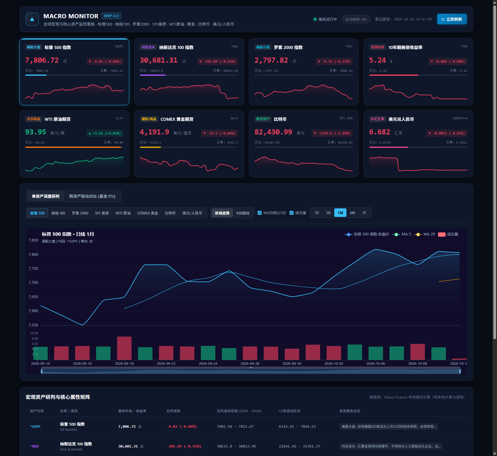
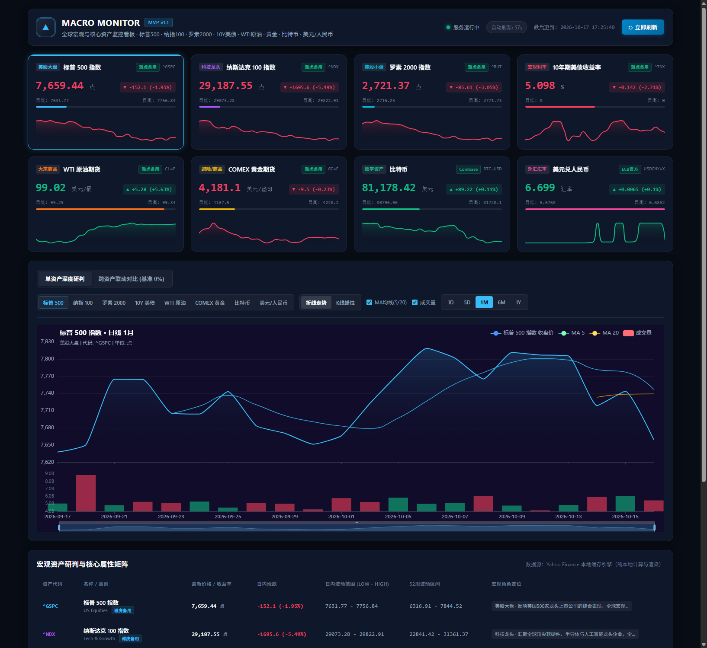

# 宏观与资产监控看板 (Macro & Asset Monitoring Dashboard)

> 一个**纯本地运行**、深色科技风格（Dark Mode）的全球宏观与核心资产行情监控网页应用（MVP 最小可行版本）。

---

## 🖥️ 监控看板全景预览

| 本地端到端运行效果 | Cloudflare 线上全球加速部署效果 |
| :---: | :---: |
|  |  |

---

## 🌟 核心特性

- **纯本地 + 云端双模式运行**：本地基于 FastAPI 后端与原生轻量前端；云端基于 Cloudflare Workers 全球边缘加速。
- **八大核心宏观资产覆盖**（支持按需联动与单资产深度研判）：
  1. **标普 500 指数 (`^GSPC`)**：美股大盘风向标，全球风险权益基准。
  2. **纳斯达克 100 指数 (`^NDX`)**：科技巨头与半导体成长股核心风向标。
  3. **罗素 2000 指数 (`^RUT`)**：美股中小市值代表，实体经济与信贷环境晴雨表。
  4. **10 年期美债收益率 (`^TNX`)**：全球无风险利率与资产定价之锚。
  5. **WTI 原油期货 (`CL=F`)**：大宗商品之母，衡量全球工业需求、地缘博弈与输入性通胀。
  6. **COMEX 黄金期货 (`GC=F`)**：避险资产与抗通胀硬通货。
  7. **比特币 (`BTC-USD`)**：数字资产与全球流动性高贝塔风向标。
  8. **美元兑人民币 (`USDCNY=X`)**：中美经济周期与经常账户汇率核心风向标。
- **高额度官方源 + 雅虎备用容灾**：
  - 数字资产直连 Coinbase Exchange 官方行情；
  - 美债收益率直连美联储（FRED 圣路易斯联储）官方基准；
  - 汇率直连欧洲央行（ECB）参考基准；
  - 雅虎财经作为自动降级兜底源，辅以 Cloudflare 全球 Edge Cache，消除限流顾虑。
- **现代深色科技 UI**：
  - 高级暗色调金融终端风格（Bloomberg / Linear 科技感）。
  - 8 大资产实时核心指标卡片，包含价格、涨跌幅、日内高低范围进度条、迷你 Sparkline 走势图与数据源认证徽章。
  - 核心属性研判与资产配置对比矩阵表格。
- **ECharts 交互式双视图图表**：
  - **单资产深度分析**：支持 `1D`（分时）、`5D`、`1M`（日线）、`6M`、`1Y` 周期切换；折线图与 K 线蜡烛图切换；MA5/MA20 移动均线与成交量柱状图切换；支持区域缩放（DataZoom）与高精十字准星 Tooltip。
  - **跨资产宏观联动对比**：以选定时段起点价格为 100% 进行归一化计算，并在统一时间轴上展现八大资产走势与 0% 盈亏基准线，直观研判股债汇金的联动效应。
- **高性能本地与边缘缓存机制**：
  - 内置内存数据缓存与 TTL 机制，秒级加载，避免重复请求上游接口导致延迟或频控。
  - 提供 60 秒倒计时自动静默刷新与“立即刷新”手动按钮。

---

## 📂 项目结构

```text
finance-dashboard/
├── backend/                   # Python 后端模块
│   ├── __init__.py
│   ├── config.py              # 资产配置、颜色定义与周期映射
│   ├── data_service.py        # yfinance 数据拉取、缓存、指标计算与归一化
│   └── main.py                # FastAPI 路由、静态文件挂载与 REST API
├── static/                    # 前端静态资源
│   ├── css/
│   │   └── style.css          # 深色模式科技主题样式
│   ├── js/
│   │   ├── echarts.min.js     # 本地自包含 ECharts 库（离线可用）
│   │   └── app.js             # 前端图表控制器与状态机
│   └── index.html             # 看板主页面
├── requirements.txt           # Python 依赖包清单
├── run.py                     # 一键启动脚本（支持自动唤起浏览器）
└── README.md                  # 项目使用与架构说明
```

---

## 🚀 快速启动指南

### 1. 安装依赖

```bash
pip install -r requirements.txt
```

### 2. 启动服务

执行根目录下的启动脚本：

```bash
python run.py
```

或直接使用 Uvicorn 启动：

```bash
uvicorn backend.main:app --host 127.0.0.1 --port 8000
```

### 3. 访问本地看板

服务启动后，默认会自动唤起浏览器。您也可以随时在浏览器中打开：
- 监控看板：[http://127.0.0.1:8000](http://127.0.0.1:8000)
- OpenAPI 交互式接口文档：[http://127.0.0.1:8000/docs](http://127.0.0.1:8000/docs)

---

## ☁️ Cloudflare 全球部署 (Serverless Edge)

本项目已集成 **Cloudflare Workers + Edge Static Assets** 全栈无服务器架构，无需任何独立云服务器，利用 Cloudflare 全球边缘网络实现毫秒级访问与边缘缓存。

### 生产环境域名

- **线上监控看板**：[https://market.505250.xyz](https://market.505250.xyz)
- **线上健康检查接口**：[https://market.505250.xyz/api/health](https://market.505250.xyz/api/health)

### 重新部署命令

```bash
# 一键部署更新到 Cloudflare Workers
npm run deploy
```

相关配置文件：
- [`wrangler.json`](file:///c:/Users/ti/Desktop/Projects/finance-dashboard/wrangler.json)：Worker 配置、静态资源映射与自定义域名绑定 (`market.505250.xyz`)。
- [`src/worker.js`](file:///c:/Users/ti/Desktop/Projects/finance-dashboard/src/worker.js)：Cloudflare Edge Worker 路由、金融数据拉取与 Edge Cache 缓存层。

---

## 🔌 API 接口规范

| 接口方法 | 路径 | 描述 |
| :--- | :--- | :--- |
| `GET` | `/api/overview` | 获取四大核心资产最新报价、日涨跌、高低价、Sparkline 数据 |
| `GET` | `/api/asset/{ticker}` | 获取指定资产的 OHLCV、K 线、收盘走势、均线及成交量数据（参数 `period`） |
| `GET` | `/api/macro-comparison` | 获取四大资产归一化百分比累计收益率对比数据（参数 `period`） |
| `POST` | `/api/refresh` | 清理后端内存缓存并强制拉取全量最新数据 |
| `GET` | `/api/health` | 服务健康监测与状态检查 |
